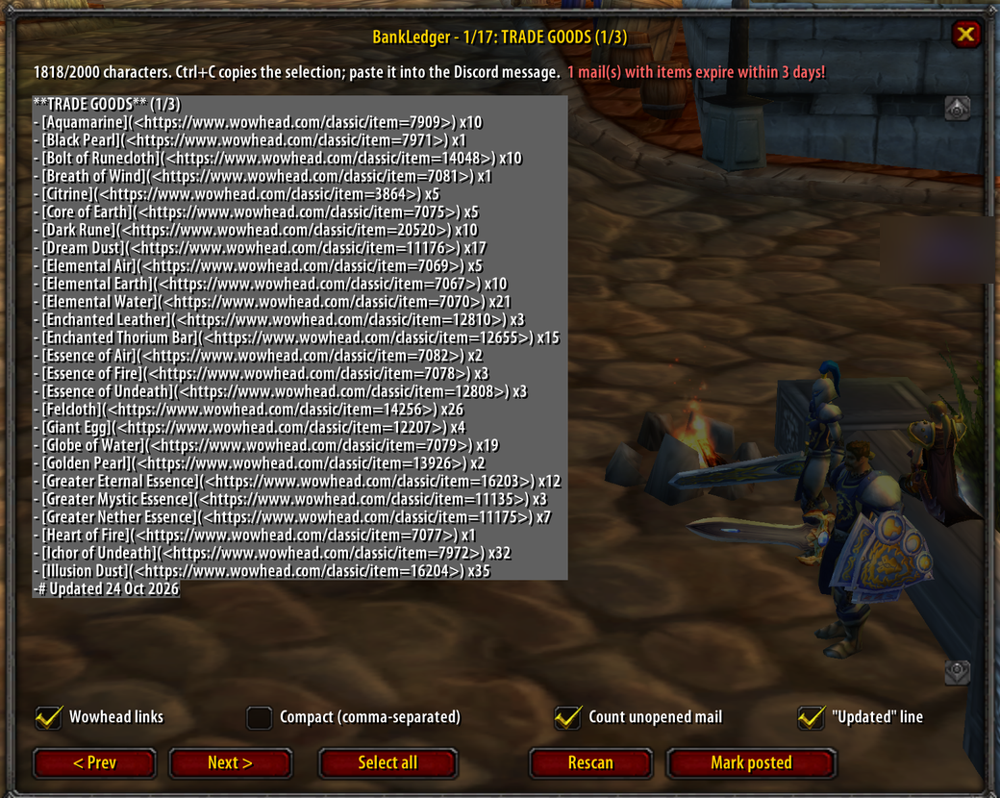
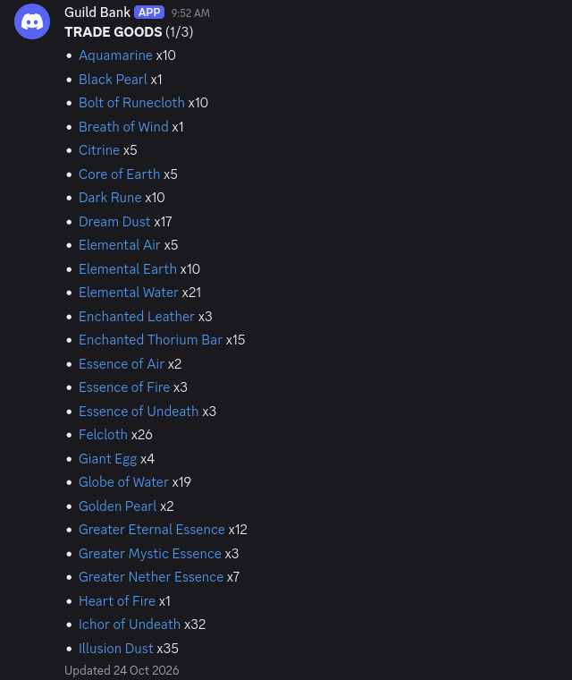
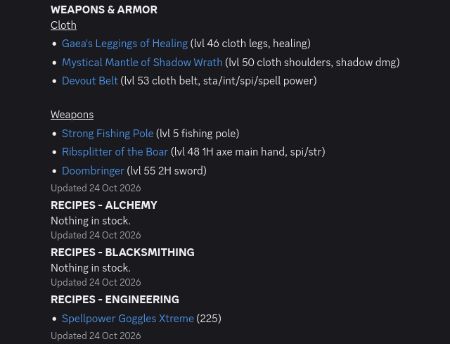

# BankLedger

WoW 1.12 (Kronos) addon for a guild bank alt. It reads bags, bank and mailbox and writes the stock as
Discord-ready text, one page per category, each under Discord's 2000 character limit. It also keeps a
ledger of mail and trades, so it can list what is new since the last post and who donated.

In game: click the bag button on the minimap (with pfUI it sits in pfUI's button bar under the minimap).
Each page is already selected, so it's Ctrl+C and paste; the tick boxes replace the commands.

What the pages look like once pasted into Discord (with `/bl links on`, item names link to wowhead):

 

## Bank alt workflow

1. Download `BankLedger-addon.zip` from the [latest release](https://github.com/GitKap/BankLedger/releases/latest)
   and unpack it into `Interface/AddOns`, so you get `Interface/AddOns/BankLedger/BankLedger.toc`.
   Restart the game (a /reload does not load new addons).
2. Log in on the bank alt. Open the bank once and the mailbox once, so both are scanned.
3. Click the bag button on the minimap (or type `/bl`) to open the report. Each page is selected already: Ctrl+C, then paste it into that category's
   Discord message (edit the message). Use `< Prev` / `Next >` to move between pages. The tick boxes under
   the text switch wowhead links, a compact comma-separated layout, counting unopened mail and the
   "Updated" line; no commands needed.
4. After updating Discord, click **Mark posted** (or `/bl mark`). The "New in the guild bank" page then
   counts from that moment and thanks everyone who mailed or traded items in.

Pages: Trade Goods, Weapons & Armor (grouped by armor type, with level, slot and main stats), Recipes per
profession (sorted by required skill, which is shown), Books & Tomes, Bags & Containers, Consumables,
Other, Gold, New in the guild bank, and an officer-only Ledger.

## Commands

| | |
|---|---|
| `/bl` | report window |
| `/bl mark` | mark the current stock as posted |
| `/bl status` | what was scanned and when |
| `/bl cat <item link or name> = TRADE GOODS` | move an item to another category (`= reset` undoes) |
| `/bl hide <item>` / `/bl unhide <item>` | leave an item out of the report |
| `/bl style list\|inline` | one item per line, or comma-separated (fits more per message) |
| `/bl links on\|off` | wowhead links on item names (longer pages) |
| `/bl stamp on\|off` | "Updated <date>" line under each page |
| `/bl mail on\|off` | count unopened mail attachments as stock |
| `/bl minimap on\|off` | show or hide the minimap button |
| `/bl off` / `/bl on` | disable on this character |

## Notes

- Soulbound items and the Hearthstone are never listed.
- Items still in the mailbox are counted. Without an item link (1.12 mail), an item the alt has never had in
  its bags lands in Other, unless its tooltip shows a recipe skill.
- SavedVariables (`BankLedgerDB`) also store the rendered pages at logout, for a later Discord webhook poster.
- Tests: `.venv/bin/python tests/sim.py [--print] [--dump pages.json]` runs the addon against a stubbed 1.12 API (`python3 -m venv .venv && .venv/bin/pip install lupa`).

## Discord webhook poster (optional)

Instead of copy-paste, the poster keeps the channel up to date by itself: after every `/reload` or logout
it edits the messages whose content changed. Two ways to run it:

- **Windows, no Python:** `BankLedgerPoster.exe` from the [latest release](https://github.com/GitKap/BankLedger/releases/latest).
  Pick the WoW folder, paste the webhook URL, tick the bank character, then Preview / Post now / Start watching.
  Settings are kept in `%APPDATA%\BankLedger`. The exe is built by GitHub Actions from this repository
  (`.github/workflows/release.yml`); it is not code-signed, so Windows SmartScreen may warn the first time
  ("More info" → "Run anyway").
- **Python 3:** `python poster/bank_gui.py` (the same window) or the command line below.

`poster/bank_post.py` posts the pages to a channel through a webhook: one message per category, edited in
place on later runs (only changed pages), reposted in order when the set of pages changes. The addon writes
its pages on `/reload`, logout or exit, so that is when an update can happen.

1. Discord: Edit Channel → Integrations → Webhooks → New Webhook → Copy Webhook URL.
2. Save it without showing it anywhere:
   `mkdir -p ~/.config/bankledger && wl-paste > ~/.config/bankledger/webhook && chmod 600 ~/.config/bankledger/webhook`
3. `python3 poster/bank_post.py --char Amberbank` (once) or add `--watch` (posts after every `/reload` or logout).
   Nothing is posted without `--char` (comma-separated or repeated) or `--all`: the addon records every
   character, and a guild channel must show only the bank alt. With several characters each heading gets the
   name ("**Amberbank · TRADE GOODS**"). `--list` shows characters with saved pages, `--skip "NEW IN"` leaves
   a page out, `--dry-run` shows the plan, `--ledger` also posts the officer page, `--repost` posts all again.

Running it all the time (Linux, systemd user service, as on my machine):
`~/.config/systemd/user/bankledger-poster.service` runs `bank_post.py --all --watch --skip "NEW IN"`;
`systemctl --user status|stop|disable bankledger-poster`, logs with `journalctl --user -u bankledger-poster`.

The script needs only the Python 3 standard library (Windows too). It runs where the game's `WTF` folder is,
so for a guild it has to run on the bank alt's computer; point it at the game with
`--wow "C:\Games\WoW 1.12"` (or `BANKLEDGER_WOW`).
